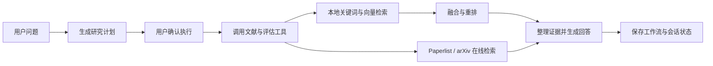

# PaperAgent

PaperAgent 是一个面向科研文献的本地工作台。它把论文管理、在线检索、混合检索和多轮问答连接到一个可观察的 Agent 工作流中：用户提交问题后，系统生成计划，由用户确认，再调用相应工具检索证据并生成结果。

项目适用于需要围绕本地论文库进行查询、整理和比较的场景。回答质量取决于可用论文内容、检索结果和模型；建议结合论文原文核对关键结论。

## 功能

- **文献库**：支持批量上传 PDF、提取论文内容并建立索引；也可记录论文标题、作者、来源、DOI、年份等元数据。
- **本地混合检索**：结合 SQLite 关键词检索与 Chroma 向量检索，融合候选片段后使用重排模型排序，返回可追溯的论文片段。
- **按需恢复索引**：普通主题查询不会重建整个个人文献库。唯一匹配到论文标题、短名称或已确认的论文 ID 时，可仅恢复该篇论文的索引；未就绪或仅有元数据的论文会产生范围提示。
- **在线搜索与入库**：支持 Paperlist MCP 和 arXiv。在线搜索默认尝试 Paperlist，在失败或无结果时可回退到 arXiv；也可明确指定来源。Paperlist 入库保存元数据及可用摘要，不等于下载完整 PDF。
- **研究工作流**：根据问题规划检索、分析、入库和结果整理等任务，支持查看计划、工具调用、进度、错误、结果，以及暂停或取消请求。
- **多轮会话**：结合近期对话和压缩摘要处理后续问题。活动会话由 Redis 管理，摘要和已完成的工作流保存在 SQLite 中，工作流还会导出为 JSON 文件。
- **聚焦测评**：提供 100 组多轮对话，覆盖混合检索、指代消解和会话压缩一致性，并提供自动重放和本地结果审阅工具。

## 工作流程



实际调用取决于问题、模型生成的计划和用户确认。题录查询、单篇论文问答和在线搜索不一定会经过相同的工具链。

## 环境要求

- Python 3.10 或更高版本。
- Node.js 和 npm，用于安装和运行 Vue 前端。
- Redis 服务；也可使用 Docker，在本机默认 Redis 不可用时由启动脚本尝试启动 Redis 容器。
- DeepSeek 或 OpenAI 兼容模型服务的 API Key；在线使用 Paperlist 需要配置对应的 Paperlist API Key。
- 可用的嵌入模型和重排模型。默认分别为 `BAAI/bge-m3` 和 `BAAI/bge-reranker-v2-m3`，可改为本地模型路径。

首次安装依赖、下载或加载模型、建立论文索引可能耗时较长。模型已下载并不意味着已加载到当前进程内存。

## 快速开始：Linux

以下命令假设已安装 Python 3.10+、Node.js 和 npm，且当前目录为仓库根目录。部分 Linux 发行版需要单独安装 Python 的 `venv` 组件。

1. 创建并激活虚拟环境：

   ```bash
   python3 -m venv .venv
   source .venv/bin/activate
   ```

2. 安装 Python 及前端依赖：

   ```bash
   python run_paperagent.py --setup
   ```

   `--setup` 会通过 pip 安装项目的 Web、论文处理和测试依赖，并在 `web/` 目录执行 `npm ci`。安装可能下载较大的模型运行依赖。

3. 创建本地配置：

   ```bash
   cp -n paperagent.config.example.json paperagent.config.json
   ```

   使用你熟悉的文本编辑器打开 `paperagent.config.json`，至少填写 `deepseek_api_key` 或 `openai_api_key`。需要 Paperlist 在线搜索时填写 `paperlist_api_key`；请从 Paperlist 服务获取自己的密钥。若模型已下载到本地，可将 `embedding_model` 和 `reranker_model` 改为实际目录，例如 `/opt/models/bge-m3`。不要提交包含密钥的配置文件。`cp -n` 不会覆盖已有配置。

   启动脚本在配置文件不存在时也会创建一份示例配置，然后退出，等待你填写配置。

4. 启动服务：

   ```bash
   python run_paperagent.py
   ```

   启动后，本地后端使用 `http://127.0.0.1:8000`，前端使用 `http://127.0.0.1:5173`。终端会显示一次性登录链接和备用 JWT；选择与已配置密钥相匹配的模型服务。按 `Ctrl+C` 停止服务。

如果没有激活虚拟环境，可将上述运行命令中的 `python` 替换为 `.venv/bin/python`。上述地址仅监听运行服务的机器本地回环地址；如果在远程 Linux 主机运行，需要通过合适的端口转发从本机访问。

## 配置

所有可用本地配置项及默认示例见 [paperagent.config.example.json](paperagent.config.example.json)。常用项如下：

| 配置项 | 用途 |
| --- | --- |
| `deepseek_api_key` / `openai_api_key` | 模型服务密钥，至少配置一个 |
| `deepseek_model` / `openai_model` | 使用的模型名称 |
| `deepseek_base_url` / `openai_base_url` | 模型服务地址 |
| `paperlist_api_key` | Paperlist MCP 在线搜索密钥 |
| `embedding_model` / `reranker_model` | 嵌入模型和重排模型名称或本地路径 |
| `redis_url` | Redis 连接地址，默认 `redis://127.0.0.1:6379/0` |
| `sqlite_path` / `chroma_path` | SQLite 数据库及 Chroma 索引目录 |
| `retrieval_limit` / `retrieval_candidates` | 返回片段数及候选片段数量 |
| `retrieval_timeout_seconds` | 单次检索的执行超时 |
| `retrieval_lock_wait_seconds` | 等待同一用户和数据库检索锁的最长时间 |
| `llm_timeout_seconds` | 模型请求超时 |
| `arxiv_search_interval_seconds` | arXiv 搜索请求间隔，默认 10 秒，不能低于 3 秒 |
| `arxiv_api_timeout_seconds` | arXiv API 请求超时 |

对应的环境变量可覆盖 JSON 文件中的值；字段与环境变量的完整映射见 [corecoder/runtime_config.py](corecoder/runtime_config.py)。更换嵌入模型或 Chroma 路径后，已有论文可能需要重新建立对应向量索引。

## 使用方式

1. 在前端登录或粘贴终端提供的 JWT，创建或加载会话。
2. 在文献库中批量上传 PDF；也可在对话中提出在线搜索需求，并按需要请求保存结果。
3. 提交问题，检查系统生成的计划后确认执行。
4. 在工作流界面查看子任务、工具状态、步骤耗时和最终结果。遇到索引未就绪或证据不足时，结合范围提示检查文献库状态。

查询某一篇论文时，提供完整标题或能唯一识别该论文的短名称更容易触发单篇索引恢复。若名称有歧义，应先从本地题录确认论文 ID。只有元数据的记录需要先补充摘要或全文，无法直接提供正文证据。普通主题检索可能只覆盖当前索引已就绪的部分，不应把未检索到当成全库不存在。

检索超时后，系统会请求后台工作在下一个安全检查点停止；如果底层模型或数据库调用一直没有返回，线程和检索锁仍可能被占用。此时请检查后端日志，必要时重启后端。范围提示及超时设置不能保证每次检索都成功。

## 数据和隐私

默认配置下，项目会在本地使用以下位置：

| 位置 | 内容 |
| --- | --- |
| `corecoder-memory.sqlite3` | 论文元数据、分块、会话摘要及已完成工作流 |
| `paperagent-chroma/` | 论文向量索引 |
| `workflow_results/` | 工作流结果和调用轨迹 JSON |
| `evaluation_results/` | 测评报告、案例轨迹和审阅索引 |
| `.paperagent-jwt-key` | 本地 JWT 签名密钥 |
| `paperagent.config.json` | 本地配置，可能包含 API Key |

这些位置可受配置影响，其中可能包含论文内容、用户问题和模型回复。向外分享文件前，请检查内容；请勿公开 API Key、JWT 或签名密钥。默认一键启动生成的本地测试 JWT 有效期为 24 小时；过期后可重新启动并使用新的令牌。Redis 中的活动会话设置了 24 小时有效期，摘要及已完成工作流另存于 SQLite。

## 测评

当前测评集位于 [evaluation/paperagent_pilot/](evaluation/paperagent_pilot/)：

- `pilot_dialogues.json`：100 组对话，其中混合检索 34 组、指代消解 33 组、会话压缩一致性 33 组。
- `evidence_index.json`：对应的候选证据与可定位锚点。候选证据未穷举，评分仍需人工复核。
- [使用与评分说明](evaluation/paperagent_pilot/使用与评分说明.md)：语料前提、运行、续跑与指标限制。

Windows CMD 中可先启动仅使用本地语料的测评服务：

```cmd
set PAPER_CORPUS_PATH=
set PAPER_EVALUATION_LOCAL_ONLY=1
python run_paperagent.py
```

保持服务运行，在另一个已激活虚拟环境的 CMD 中先试跑两个案例：

```cmd
python evaluation/run_pilot.py --cases F100-001 F100-035
```

确认环境和裁判正常后，运行全部案例：

```cmd
python evaluation/run_pilot.py
```

测评默认启用模型裁判，会消耗 API 额度，并向所选模型服务发送问题、回答、工具结果和参考片段。`--no-judge` 仅采集轨迹，不会给出语义评分。若依赖的论文尚未就绪，可先恢复对应索引，或使用 `--skip-unready` 跳过并在报告中记录；跳过后实际执行数可能少于 100。测评集共 409 个用户轮次，完整运行可能耗时较长。模型裁判不是人工金标，证据不足或裁判失败的案例应单独统计。

结果保存在 `evaluation_results/`。运行结束后可打开报告目录内的 `review.html` 或 `review.csv`；如需重新生成本地审阅索引：

```cmd
python evaluation/review_report.py "evaluation_results\pilot-实际目录名"
```

旧版 320 组报告与当前 100 组是不同数据集，不能混用续跑或直接比较为同一组结果。

## 开发与验证

```cmd
python run_paperagent.py --check
```

该命令执行 Python 测试、前端测试、类型检查和构建。也可分别运行：

```cmd
python -m pytest tests/ -q
cd web
npm test
npm run build
```

主要目录：

```text
corecoder/papers/       论文解析、存储、检索、在线来源
corecoder/workflow/     工作流调度、工具调用和结果校验
corecoder/web.py        FastAPI 接口
web/                    Vue 前端
run_paperagent.py       本地安装、检查与启动入口
evaluation/             测评数据、运行与审阅工具
```

## 许可证与来源

本项目包含基于 CoreCoder 的代码，保留原项目的 MIT 许可证和版权声明。详见 [LICENSE](LICENSE)。
